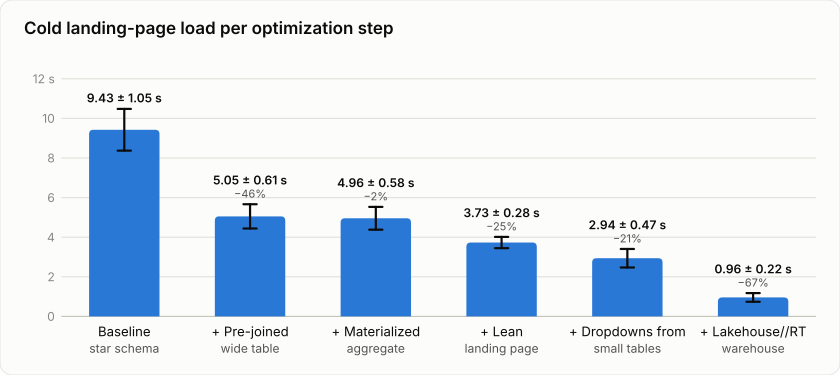

# From 9.4 s to 1 s: what actually makes a Databricks AI/BI dashboard load fast

*A benchmark of five optimization techniques, 10 runs each*

When teams move dashboards from Tableau to Databricks AI/BI, the first question is often "will it be fast?" The second
is "what do we change if it isn't?" Opinions are easy to find. We wanted numbers. So we rebuilt a real-world Tableau
dashboard on AI/BI, a "Sales Performance | Overview" page with product ratings by country, brand and week. Then we
applied common performance techniques one at a time and measured each one.

## The setup

- **Data:** a 10-million-row synthetic star schema in Unity Catalog. One fact table of product sales plus six
  dimensions (customers, products, weeks, countries, brands, pack sizes). That means every chart needs joins.
- **Dashboard:** 16 filters (all dashboard parameters, several multi-select) and a main "Product Rating" chart with 11
  more line charts on the landing page. The metrics are Tableau-style level-of-detail (LOD) calculations with three
  aggregation levels. The denominator is computed on the fly after filters.
- **Compute:** one serverless SQL warehouse (PRO, Small, a single cluster with no autoscaling), so we compare designs,
  not cluster counts. The last step uses a Lakehouse//RT (real-time) warehouse of the same size.
- **Two measurements, 10 runs each:**
  - **Replay** fires all of the landing page's queries in parallel straight at the warehouse. That is the pure query
    cost.
  - **Browser** opens the published dashboard in Chrome and times it until the last result arrives. That is what a
    user sees.
- **Two load types:**
  - **First load:** all caches invalidated (new Delta versions on every table and a full refresh of the materialized
    view). The query history confirms that no query was served from cache.
  - **Subsequent load:** a page reload that hits the cache.

The steps are cumulative. Each one builds on the previous.

*Browser first load per step, from 9.4 s to 1.0 s. Mean of 10 runs with all caches invalidated; error bars and "±" are
one standard deviation, % is the change vs the previous bar. Serverless PRO Small, last bar Lakehouse//RT Small.*

## Results

Sorted by impact (browser first load, change vs the previous step). Load times are mean ± standard deviation of 10
runs; changes are ± one standard error. We tested each step against the previous one with a Welch t-test.

| Step | Browser before | Browser after | Change (browser) | Replay before | Replay after | Change (replay) |
|---|---:|---:|---:|---:|---:|---:|
| Lakehouse//RT warehouse | 2.94 ± 0.47 s | 0.96 ± 0.22 s | **−67% ± 3** | 2.16 ± 0.40 s | 0.36 ± 0.14 s | −83% ± 2 |
| Pre-joined wide table instead of a star schema | 9.43 ± 1.05 s | 5.05 ± 0.61 s | **−46% ± 3** | 7.70 ± 0.54 s | 4.72 ± 0.53 s | −39% ± 3 |
| Only the main chart on the landing page | 4.96 ± 0.58 s | 3.73 ± 0.28 s | **−25% ± 3** | 3.91 ± 0.44 s | 2.14 ± 0.45 s | −45% ± 4 |
| Filter dropdowns fed from small dimension tables | 3.73 ± 0.28 s | 2.94 ± 0.47 s | **−21% ± 4** | 2.14 ± 0.45 s | 2.16 ± 0.40 s | +1% ± 9 |
| Materialized aggregate at chart grain | 5.05 ± 0.61 s | 4.96 ± 0.58 s | −2% ± 5 (not significant) | 4.72 ± 0.53 s | 3.91 ± 0.44 s | −17% ± 4 |
| **All measures together** | **9.43 ± 1.05 s** | **0.96 ± 0.22 s** | **−90% ± 1** | **7.70 ± 0.54 s** | **0.36 ± 0.14 s** | **−95% ± 1** |

The order in which we applied them was: pre-join, materialized aggregate, lean landing page, dropdowns, Lakehouse//RT.

Subsequent (cached) loads take about 1.9–2.4 s in the browser for every step. Most of that, about 1.6–1.9 s, is the
dashboard app loading before the first query is sent.

## What we learned

**1. Lakehouse//RT is the single largest lever.** Switching the optimized dashboard to a Lakehouse//RT warehouse took
the browser first load from 2.9 s to under 1 s. Even the unoptimized baseline got 66% faster on RT (replay 7.7 s to
2.6 s). One caveat: on one Small cluster, RT's advantage shrinks under concurrency. It is about 5x faster for a single
query and about 3x for a page of 28 queries.

**2. Pre-join your data.** This was the biggest modelling gain: −46% in the browser. Every chart and every filter
dropdown in the baseline joined seven tables. The 2-million-row customer dimension alone was about half of the join
cost. One wide table removes that work from every query.

**3. Put fewer queries on the landing page.** Moving 11 secondary charts to a "Deep Dive" page cut the first load by a
quarter. It cut almost half in the replay. On a single cluster, 28 concurrent queries queue behind each other. Every
widget you take off the first page is one less query in that queue.

**4. Don't feed filter dropdowns from the fact table.** This one surprised us. In the replay it made no difference,
because the dropdown queries are cheap single-column scans that run fully in parallel. In the browser it saved
0.8 s (−21%, clearly significant with 10 runs). With only 3 runs it had looked like noise. That is a good reminder to
measure more than once. Pointing dropdowns at small dimension tables is easy, so do it.

**5. Pre-aggregation helps the charts but can be hidden.** A materialized view at product × country × week grain
(772k rows instead of 10M) made the landing-page queries 17% faster in the replay. In the browser the gain was within
noise, because the filter dropdowns were still scanning the big table at that point. Fix the dropdowns and the
pre-aggregation pays off fully.

**6. Optimize for the cold path.** Cached loads look alike across all steps. What differs is the first load and every
filter change. New parameter values mean new, uncached queries, and those are what your users feel.

## Why not just switch to Lakehouse//RT?

If RT is the largest lever, why bother with the modelling work? Because a single dashboard on an idle warehouse is not
how dashboards run in production, and RT alone leaves most of the gain on the table:

- **RT alone is still 7x slower.** The unoptimized baseline on RT needs 2.6 s of pure query time for its landing page.
  With all measures it needs 0.36 s. That is the same warehouse, doing far less work.
- **Every dashboard open costs warehouse capacity.** The baseline landing page fires 28 queries, each joining seven
  tables. Added up, those queries ran for about 55 s on RT per cold open. The optimized page fires 17 queries that add
  up to about 3 s, roughly 18x less. A warehouse that serves one baseline dashboard could serve many optimized ones.
- **Shared warehouses queue.** In practice many dashboards and users share one warehouse. Every cold open and every
  filter change sends new, uncached queries. Their wait time grows with the number of queries in flight, not just
  with how fast each one runs. We already saw this on a single page: 28 concurrent queries cut RT's advantage from
  about 5x to about 3x. With many dashboards at once, heavy queries from one dashboard slow down all the others.
- **The alternative is scaling out.** When queries queue, the warehouse adds clusters (if autoscaling allows it), and
  you pay for them. Lean dashboards keep more users on fewer clusters. The modelling work is done once; the extra
  compute for joins and unneeded widgets is paid on every load.

RT makes good dashboards fast. The modelling measures make sure a shared warehouse can keep them fast for many users
at once.

## The playbook

1. Pre-join into one wide table (or a small number of them).
2. Keep the landing page lean and move detail charts to secondary pages.
3. Feed filter dropdowns from small dimension tables or static lists.
4. Add a materialized aggregate at the grain your charts need.
5. Run the dashboard on Lakehouse//RT if you need sub-second loads, on top of steps 1–4, not instead of them.

Together these took the landing page from **9.4 s to 1.0 s** cold in the browser, **a 90% reduction**.

## Caveats

The data is synthetic (10M rows) and modelled on the original dashboard; the values are not real business numbers.
Everything ran on one Small cluster without autoscaling. Larger data or more users will shift the absolute numbers,
and the dropdown and pre-aggregation effects should grow with table size. The summed query times above are each
query's latency under the same parallel load, so they show how long the warehouse is busy, not exact compute cost.
In our runs, the aggregate (and the steps after it) was queried through a Unity Catalog metric view; on its own, that
layer made no significant difference to load time. Lakehouse//RT is in Beta. Its first query after idling takes about
2 s. In this setup, filter selections on the Overview page don't carry over to the Deep Dive page, because it uses
page-level filters; global filters would fix that.
